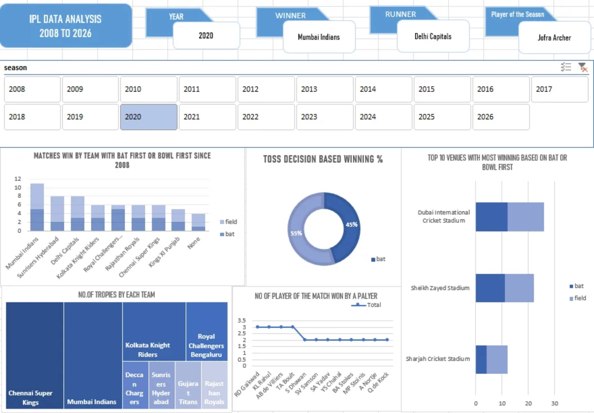

# 🏏 IPL Data Analysis Dashboard (2008–2026)

## 📌 Project Overview

This is my first Data Analyst project, where I used IPL (Indian Premier League) data collected from Kaggle to create an interactive data analysis dashboard using Microsoft Excel.

The main objective of this project is to analyze IPL statistics, understand team performances, identify match-winning trends, and present meaningful insights through data visualization.

## 📂 Dataset Source

- Platform: Kaggle
- Dataset: IPL Dataset
- Data Coverage: 2008–2026
- Source Link: https://www.kaggle.com/datasets/yusufmurtaza01/ipl-dataset-year-wise

## 📊 Dashboard Features

The Excel dashboard includes the following analysis:

1. Matches won by teams based on batting first or bowling first.
2. Toss decision analysis and winning percentage.
3. Top 10 venues based on most wins.
4. Number of IPL trophies won by each team.
5. Player of the Match analysis.

## 🛠️ Tools & Technologies

- Microsoft Excel
- Data Analysis
- Data Visualization
- Excel Charts

## 🎯 Project Objectives

- Understand IPL match statistics.
- Analyze team performance across seasons.
- Identify winning trends based on toss decisions.
- Visualize cricket data through an Excel dashboard.
- Develop practical data analyst skills.

## 📸 Dashboard Preview

## 📚 Key Learnings

- Working with real-world datasets from Kaggle.
- Understanding data analysis concepts.
- Creating charts and visualizations in Excel.
- Building an analytical dashboard.
- Presenting data insights in a structured way.

## 👨‍💻 Author

**Putthur Tharun Achari**

Aspiring Data Analyst | Computer Science & Engineering (AI & ML)

## ⭐ Project Status

Completed – First Data Analyst Project.

